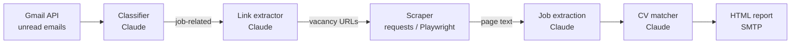

# AI Gmail Summarizer

An LLM pipeline that turns a noisy inbox of job alerts into a short, ranked shortlist.

It reads unread emails, uses Claude to pick out the job-related ones, extracts vacancy links, scrapes each posting
(including JS-rendered and login-walled sites), scores every vacancy against the candidate's CV, and emails an HTML
report sorted by fit.

Built for daily personal use across several job boards (LinkedIn, XING, Indeed, jobs.ch, JobScout24, and others) and
several candidate profiles.

## How it works



| Stage | Module | What it does |
|---|---|---|
| Fetch | `gmail.py` | OAuth 2.0, fetch unread Primary emails, mark as read, send the report via SMTP |
| Classify | `classifier.py` | One batched Claude call that returns the IDs of job-related emails |
| Extract links | `link_extractor.py` | Parses URLs from HTML/text; Claude separates vacancy links from unsubscribe, tracking, and homepage links |
| Scrape | `scraper.py` | Two-tier fetch: plain `requests` first, falling back to Playwright for JS-rendered sites. Handles tracking redirects, auto-login, and session persistence |
| Match | `matcher.py` | Claude compares each vacancy to the CV and returns a fit percentage, summary, matches, and gaps |
| Report | `report.py` | Color-coded HTML email (green ≥ 70%, yellow ≥ 50%, red < 50%) |

## Design notes

- **Structured output from LLMs.** Every Claude call is prompted to return JSON, which is parsed (after stripping
  Markdown code fences) into typed results for the next stage.
- **Resumable pipeline.** State is saved after each stage. `--resume` skips completed stages, so a scraping failure
  does not cost the classification and extraction calls again.
- **Per-profile rules.** Each profile has its own CV and an optional `matcher_instructions.md` with natural-language
  ranking rules (rank higher, rank lower, skip). The matcher applies them on top of the CV comparison.
- **Pragmatic scraping.** One browser session is reused for the whole batch. Login state is persisted per site.
  Redirect domains are resolved before scraping, and sites that need a real browser (LinkedIn, XING, Indeed) go
  straight to Playwright.
- **Standalone tools.** `tools/` exposes each stage as a small CLI (fetch, scrape, match, build report, send), so the
  pipeline can also be driven step by step by an agent, such as a Claude Code slash command
  (`.claude/commands/summarize-gmail.md`).

## Setup

Requires Python 3.12 and [uv](https://docs.astral.sh/uv/).

```bash
uv sync --group dev
uv run playwright install chromium
cp .env.example .env          # add ANTHROPIC_API_KEY and SMTP settings
cp -r profiles/example profiles/<name>
```

In `profiles/<name>/`:

- `config.yaml` sets the recipient, the minimum fit percentage, and optional job-board credentials
- `cv.md` holds the candidate's CV in Markdown
- `matcher_instructions.md` (optional) holds custom ranking rules
- `credentials.json` holds the Gmail OAuth client credentials from Google Cloud Console

`token.json`, `state.json`, and browser session files are generated at runtime and gitignored.

## Usage

```bash
uv run gmail-summarizer --profile <name>            # full pipeline
uv run gmail-summarizer --profile <name> --resume   # continue from the last completed stage
```

The Claude model is configurable via `CLAUDE_MODEL` in `.env`.

## Development

```bash
uv run pytest
uv run ruff check src/ tests/
uv run ruff format --check src/ tests/
```
